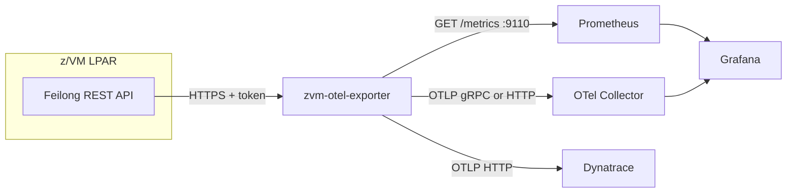

# z/VM OTel exporter

Prometheus and OpenTelemetry exporter for [z/VM](https://www.ibm.com/products/zvm) host and guest metrics. It reads the [Feilong](https://github.com/openmainframeproject/feilong) REST API (the maintained z/VM SDK and cloud connector) and publishes one scrape both as a Prometheus `/metrics` endpoint and as OTLP metrics.

This is a successor to [zvm_exporter](https://github.com/zvmexporter/zvm_exporter) (2016–2017). That project scraped xCAT, which is no longer maintained, and exposed CPU, memory, disk, paging, and spool metrics on port **9110**. The [Open Mainframe Project 2020 mentorship](https://mentorship.linuxfoundation.org/programs/open-mainframe-project-2020-mentorship-enhance-zvm-prometheus-exporter) proposed rebuilding it on Feilong. This repository is that rebuild, with OTLP added so the same series can go to an OpenTelemetry Collector or directly to Dynatrace.

It has been tested against a fixture Feilong server. It has not yet been run against a live z/VM system. Treat the unit conversions in the metrics table as a contract to confirm on real hardware.

## Architecture



One process scrapes Feilong on an interval and keeps the latest snapshot in memory.

* The Prometheus registry renders that snapshot when something scrapes `/metrics`. The default listen port is 9110, matching the old exporter.
* When OTLP is enabled, observable instruments read the same snapshot and a periodic reader exports them.
* If Feilong cannot be reached, the process stays up, `/metrics` and `/health` still answer, `zvm.exporter.up` is 0, and the previous z/VM series stay available with `zvm.exporter.scrape.stale` set to 1.

Feilong authentication is the admin-token flow. `POST /token` sends the long-lived token from `/etc/zvmsdk/token.dat` in the `X-Admin-Token` header. Feilong returns a session token in `X-Auth-Token`. The exporter caches that session token and exchanges a new one after a single HTTP 401. Set `auth: none` only when the Feilong server has token checks disabled.

The exporter does not call `GET /guests/{userid}`. That route returns the user directory entry, and Feilong documents that the password is in clear text.

Tokens are accepted from the config file, the environment, or the CLI. They are omitted from `repr` and stripped from log records. HTTP client loggers are pinned to WARNING so they do not echo headers. The process does not honor `HTTP_PROXY` (`trust_env` is off) so a Feilong token is not sent to an ambient proxy.

## Quick start

Requires Python 3.11 or newer. No mainframe is required for the fixture path.

```bash
python -m pip install .
zvm-otel-exporter-mock --port 8080
```

In another shell:

```bash
zvm-otel-exporter \
  --feilong-url http://127.0.0.1:8080 \
  --feilong-admin-token test-admin-token \
  --no-verify-tls \
  --port 9110
curl -s localhost:9110/metrics | head
curl -s localhost:9110/health
```

`test-admin-token` is the mock server's fixture. A real Feilong admin token belongs in the environment, not on the command line of a shared host:

```bash
export ZVM_EXPORTER_FEILONG_URL=https://feilong.example.com:8080
export ZVM_EXPORTER_FEILONG_ADMIN_TOKEN='the-token-from-token.dat'
export ZVM_EXPORTER_FEILONG_CA_FILE=/etc/zvm-exporter/ca.pem
zvm-otel-exporter --config /etc/zvm-exporter/config.yaml
```

`--once` scrapes a single time, writes Prometheus text to stdout, flushes OTLP if it is enabled, and exits 0 when host information was collected.

A ready-to-edit file is in [`examples/config.yaml`](examples/config.yaml). A Prometheus scrape fragment is in [`examples/prometheus-scrape.yaml`](examples/prometheus-scrape.yaml).

### Docker

```bash
docker build -t zvm-otel-exporter .
docker run --rm -p 9110:9110 \
  -e ZVM_EXPORTER_FEILONG_URL=https://feilong.example.com:8080 \
  -e ZVM_EXPORTER_FEILONG_ADMIN_TOKEN \
  -e ZVM_EXPORTER_FEILONG_VERIFY_TLS=true \
  -v /etc/zvm-exporter/config.yaml:/etc/zvm-exporter/config.yaml:ro \
  zvm-otel-exporter
```

The image runs as uid 65534 and expects the config file at `/etc/zvm-exporter/config.yaml`. Prefer passing the admin token with `-e ZVM_EXPORTER_FEILONG_ADMIN_TOKEN` (forwarded from the host environment) or an env file over writing it into the image.

### systemd

Create a system user and install the unit from [`examples/systemd/zvm-otel-exporter.service`](examples/systemd/zvm-otel-exporter.service):

```bash
sudo useradd --system --home-dir /nonexistent --shell /usr/sbin/nologin zvm-exporter
sudo install -d -o root -g zvm-exporter -m 0750 /etc/zvm-exporter
sudo install -o root -g zvm-exporter -m 0640 examples/config.yaml /etc/zvm-exporter/config.yaml
sudo install -o root -g zvm-exporter -m 0640 /dev/null /etc/zvm-exporter/environment
# put ZVM_EXPORTER_FEILONG_ADMIN_TOKEN=... into that environment file
sudo install -m 0644 examples/systemd/zvm-otel-exporter.service /etc/systemd/system/
sudo systemctl daemon-reload
sudo systemctl enable --now zvm-otel-exporter
```

## Configuration

Precedence is the YAML file, then environment variables, then CLI flags. A later layer replaces a single field. OTLP headers and disk-pool lists are replaced as a whole, not merged key by key.

| Setting | CLI | Environment | Default |
| --- | --- | --- | --- |
| Config file | `--config` | `ZVM_EXPORTER_CONFIG` | none |
| Feilong URL | `--feilong-url` | `ZVM_EXPORTER_FEILONG_URL` | required |
| Admin token | `--feilong-admin-token` | `ZVM_EXPORTER_FEILONG_ADMIN_TOKEN` | required for `auth: token` |
| Session token | `--feilong-auth-token` | `ZVM_EXPORTER_FEILONG_AUTH_TOKEN` | empty |
| Auth mode | `--auth token\|none` | `ZVM_EXPORTER_FEILONG_AUTH` | `token` |
| TLS verify | `--verify-tls` / `--no-verify-tls` | `ZVM_EXPORTER_FEILONG_VERIFY_TLS` | `true` |
| CA bundle | `--ca-file` | `ZVM_EXPORTER_FEILONG_CA_FILE` | system trust |
| Feilong timeout | `--timeout` | `ZVM_EXPORTER_FEILONG_TIMEOUT` | 30 seconds |
| Disk pools | `--disk-pool` (repeatable) | `ZVM_EXPORTER_FEILONG_DISK_POOLS` | Feilong's default pool |
| Listen address | `--listen` | `ZVM_EXPORTER_LISTEN` | `0.0.0.0` |
| Listen port | `--port` | `ZVM_EXPORTER_PORT` | `9110` |
| Scrape interval | `--scrape-interval` | `ZVM_EXPORTER_SCRAPE_INTERVAL` | 60 seconds |
| Prometheus | `--prometheus` / `--no-prometheus` | `ZVM_EXPORTER_PROMETHEUS_ENABLED` | `true` |
| OTLP | `--otlp` / `--no-otlp` | `ZVM_EXPORTER_OTLP_ENABLED` | `false` |
| OTLP endpoint | `--otlp-endpoint` | `ZVM_EXPORTER_OTLP_ENDPOINT` | required when OTLP is on |
| OTLP protocol | `--otlp-protocol grpc\|http` | `ZVM_EXPORTER_OTLP_PROTOCOL` | `grpc` |
| OTLP headers | `--otlp-header Key=Value` | `ZVM_EXPORTER_OTLP_HEADERS` | none |
| OTLP insecure | `--otlp-insecure` | `ZVM_EXPORTER_OTLP_INSECURE` | `false` |
| Log level | `--log-level` | `ZVM_EXPORTER_LOG_LEVEL` | `INFO` |

`ZVM_EXPORTER_OTLP_HEADERS` is either a JSON object or comma-separated `Key=Value` pairs. Use JSON when a value contains a comma. Each collector can be toggled with `ZVM_EXPORTER_COLLECTOR_<NAME>`, for example `ZVM_EXPORTER_COLLECTOR_PCIF=true`.

Disk pool names use Feilong's `TYPE:name` form, such as `ECKD:eckdpool1`. With an empty list the exporter calls `GET /host/diskpool` once and lets Feilong use the pool from its own configuration. The `zvm.disk.pool` label is the name you configured, or the pool name embedded in a details response, or `default` when neither is present.

Guest stats and NIC stats are requested in batches (`feilong.batch_size`, default 25). Power state and minidisks are one HTTP call per managed guest, bounded by `feilong.max_guests` (default 500) and `feilong.concurrency` (default 8). Raise the scrape interval before raising those caps on a large system.

## Metrics

OpenTelemetry names are the source of truth. Dots separate the namespace. Prometheus names replace dots with underscores, append a unit suffix (`By` becomes `bytes`, `s` becomes `seconds`, `{cpu}` becomes `cpus`), and add `_total` on counters.

Examples:

| OTel name | Prometheus name |
| --- | --- |
| `zvm.host.cpu.count` | `zvm_host_cpu_count_cpus` |
| `zvm.guest.cpu.time` | `zvm_guest_cpu_time_seconds_total` |
| `zvm.host.memory.usage` | `zvm_host_memory_usage_bytes` |
| `zvm.exporter.up` | `zvm_exporter_up` |

Attribute keys become labels the same way: `zvm.host.name` becomes `zvm_host_name`, `network.io.direction` becomes `network_io_direction`.

Guest CPU time is the useful CPU graph. `rate(zvm_guest_cpu_time_seconds_total[5m])` is approximately the number of cores the guest consumed. Feilong does not return a system-wide busy percentage.

### Host and Feilong

| Metric | Type | Source | Meaning |
| --- | --- | --- | --- |
| `zvm.host.info` | gauge | `GET /host` | Always 1. Labels carry the hypervisor name, z/VM system name, version, CEC model, architecture, IPL time, and the Feilong connector userid. |
| `zvm.host.cpu.count` | gauge | `vcpus` | Logical CPUs (`lpar_cpu_total`). Parity with the old `zvm_system_cpu_count`. |
| `zvm.host.cpu.used` | gauge | `vcpus_used` | Logical CPUs Feilong reports as in use (`lpar_cpu_used`). This is a count, not the old `zvm_system_cpu_in_use` ratio. |
| `zvm.host.memory.limit` | gauge | `memory_mb` | LPAR memory, converted from mebibytes to bytes. Parity with `zvm_system_memory_total`, in bytes. |
| `zvm.host.memory.usage` | gauge | `memory_mb_used` | LPAR memory in use, converted to bytes. Parity with `zvm_system_memory_in_use`. |
| `zvm.host.disk.limit` | gauge | `disk_total` | Sum of Feilong's configured disk pools. Feilong already rounds to whole gigabytes; the exporter multiplies by 1024 cubed. |
| `zvm.host.disk.usage` | gauge | `disk_used` | Same conversion as the limit. |
| `zvm.host.disk.available` | gauge | `disk_available` | Same conversion. Closest pool-level parity with `zvm_disk_space_free`. |
| `zvm.feilong.info` | gauge | `GET /` | Always 1. Labels are the Feilong version and API version. |
| `zvm.smapi.healthy` | gauge | `GET /smapi_health` | 1 when Feilong says SMAPI is healthy. |
| `zvm.smapi.calls` | counter | `totalSuccess`, `totalFail` | Label `zvm.smapi.call.state` is `success` or `fail`. |
| `zvm.smapi.continuous_failures` | gauge | `continuousFail` | Current consecutive SMAPI failure streak. |

`GET /host` includes disk totals only when Feilong itself has `disk_pool` configured. Those numbers are the sum of those pools, not every DASD on the LPAR. Prefer the disk-pool metrics below when you name the pools yourself.

### Disk pools

| Metric | Type | Source | Meaning |
| --- | --- | --- | --- |
| `zvm.disk_pool.limit` | gauge | `GET /host/diskpool` | `disk_total` in bytes, label `zvm.disk.pool`. |
| `zvm.disk_pool.usage` | gauge | same | `disk_used` in bytes. |
| `zvm.disk_pool.available` | gauge | same | `disk_available` in bytes. |
| `zvm.disk_pool.volume.free` | gauge | `details=true` | Per-volume `free_size`. Feilong does not name the unit. On ECKD pools this is cylinders, which is the closest reading of the old per-volume `zvm_disk_space_free`. It is not bytes. |

The details payload in the Feilong docs is a pool-name key whose value is a list of volume records. The parser also accepts a `volumes` list and summary fields beside it. Confirm the shape on a real system; volume series are skipped when `free_size` is absent.

### Guests

| Metric | Type | Source | Meaning |
| --- | --- | --- | --- |
| `zvm.guests` | gauge | `GET /guests`, `GET /host/guests` | Label `zvm.guest.scope` is `managed` (Feilong's database) or `host` (the host list). |
| `zvm.guest.cpu.count` | gauge | `GET /guests/stats` | `guest_cpus`. |
| `zvm.guest.cpu.min` | gauge | `min_cpu_count` | Minimum virtual CPUs Feilong reports. |
| `zvm.guest.cpu.max_limit` | gauge | `max_cpu_limit` | Passed through. The published sample is 10000 for a 2-CPU guest, so do not alert on it as a CPU count. |
| `zvm.guest.cpu.time` | counter | `used_cpu_time_us` | Seconds. Rate is approximate cores used. |
| `zvm.guest.cpu.elapsed_time` | counter | `elapsed_cpu_time_us` | Seconds. |
| `zvm.guest.cpu.samples` | counter | `samples_cpu_in_use`, `samples_cpu_delay` | Label `zvm.cpu.sample.state` is `in_use` or `delay`. Other monitor buckets are not in the API, so this is not a utilization ratio. |
| `zvm.guest.memory.usage` | gauge | `used_mem_kb` | Bytes. |
| `zvm.guest.memory.limit` | gauge | `max_mem_kb` | Bytes. |
| `zvm.guest.memory.min` | gauge | `min_mem_kb` | Bytes. Feilong's prose for this field says "maximum"; the field name is `min`. |
| `zvm.guest.memory.shared` | gauge | `shared_mem_kb` | Bytes. |
| `zvm.guest.memory.total` | gauge | `total_memory` | Bytes, assuming kilobytes. The API does not name the unit. |
| `zvm.guest.memory.available` | gauge | `available_memory` | Bytes, same assumption. |
| `zvm.guest.memory.free` | gauge | `free_memory` | Bytes, same assumption. |
| `zvm.guest.up` | gauge | `GET /guests/{id}/power_state` | 1 when `on`, 0 when `off`. Label `zvm.power.state` repeats the state. |
| `zvm.guest.network.io` | counter | `GET /guests/interfacestats` | Bytes. `network.io.direction` is `receive` or `transmit`. |
| `zvm.guest.network.packets` | counter | `nic_fr_rx`, `nic_fr_tx` | Frames, same direction label. |
| `zvm.guest.network.errors` | counter | `nic_fr_rx_err`, `nic_fr_tx_err` | Frame errors. |
| `zvm.guest.network.dropped` | counter | `nic_fr_rx_dsc`, `nic_fr_tx_dsc` | Discarded frames. |
| `zvm.guest.disk.size` | gauge | `GET /guests/{id}/disks` | Configured minidisk size in `zvm.disk.units` (often cylinders). Off unless `collectors.minidisks` is true. Capacity, not used space. |

NIC series also carry `network.interface.name` (the virtual device) and `zvm.vswitch.name`.

### Virtual switches, SSI, and PCI

| Metric | Type | Source | Meaning |
| --- | --- | --- | --- |
| `zvm.vswitch.up` | gauge | `GET /vswitches/{name}` | 1 when the status text contains "ready". |
| `zvm.vswitch.authorized_users` | gauge | `authorized_users` | Count of authorized userids, not one series per user. |
| `zvm.vswitch.adapters` | gauge | `adapters` | Coupled guest adapters. |
| `zvm.vswitch.uplink_devices` | gauge | `real_devices` | Real OSA devices. |
| `zvm.ssi.member.joined` | gauge | `GET /host/ssi` | 1 when `member_state` is Joined. No series when the response is an empty list, which means the host is not in an SSI cluster. |
| `zvm.pcif.enabled` | gauge | `GET /host/pcif` | 1 when the PCI function state is ENABLED. Off by default. |

### Exporter

| Metric | Type | Meaning |
| --- | --- | --- |
| `zvm.exporter.info` | gauge | Always 1. Label `service.version`. |
| `zvm.exporter.up` | gauge | 1 when this scrape collected host information. |
| `zvm.exporter.scrape.duration` | gauge | Seconds spent in the scrape. |
| `zvm.exporter.scrape.errors` | counter | Failed Feilong calls since the process started. |
| `zvm.exporter.scrape.stale` | gauge | 1 when host collection failed and older z/VM series are still being served. |
| `zvm.exporter.scrape.last_success` | gauge | Unix time of the last scrape that collected host information. |

## Gaps relative to the 2017 exporter

Feilong's read API does not expose everything xCAT's SMAPI queries did. These are omitted on purpose. The exporter does not invent zeros for them.

| 2017 metric | Status |
| --- | --- |
| `zvm_system_cpu_count` | Replaced by `zvm.host.cpu.count`. |
| `zvm_system_cpu_in_use` | Not available. Feilong has no system CPU utilization ratio. Use the rate of `zvm.guest.cpu.time`, and `zvm.host.cpu.used` as a CPU count. |
| `zvm_system_memory_total`, `zvm_system_memory_in_use` | Replaced by `zvm.host.memory.limit` and `zvm.host.memory.usage`, in bytes. |
| `zvm_disk_space_total`, `zvm_disk_space_free`, `zvm_disk_status` | Partial. Pool totals are in bytes after Feilong's whole-gigabyte rounding. Per-volume free space is in directory-manager units, not bytes, and there is no online/offline status bit. |
| `zvm_page_allocated_total`, `zvm_page_used_total` | No paging API. Page space (`QUERY ALLOC PAGE`) is not exposed. |
| `zvm_spool_allocated_total`, `zvm_spool_used_total` | No spool API. Spool space (`QUERY ALLOC SPOOL`) is not exposed. |

Other limits found while reading Feilong 1.6:

* There is no batch power-state route, so power state costs one request per guest.
* `GET /host/pcif` returns an error when the host has no PCI functions, instead of an empty list. Leave that collector off unless you know the LPAR has them.
* `GET /guests/stats` is the batched CPU and memory source. `total_memory`, `available_memory`, and `free_memory` have no unit in the specification. This exporter treats the published sample as kilobytes.
* Guest minidisk size is configured capacity. Feilong does not report bytes used inside a minidisk.
* SSI information is a list of `key = value` strings, not a structured object. The parser follows that format.

## OpenTelemetry Collector

[`examples/otel-collector.yaml`](examples/otel-collector.yaml) receives OTLP/gRPC on 4317 and OTLP/HTTP on 4318 and exposes a Prometheus endpoint on 8889.

```bash
zvm-otel-exporter \
  --feilong-url https://feilong.example.com:8080 \
  --feilong-admin-token "$ZVM_EXPORTER_FEILONG_ADMIN_TOKEN" \
  --otlp \
  --otlp-protocol grpc \
  --otlp-endpoint http://otel-collector:4317
```

An `http://` gRPC endpoint is exported without TLS. Use an `https://` endpoint for a collector that presents a certificate, and set `ZVM_EXPORTER_OTLP_INSECURE=false`.

For OTLP/HTTP, a base URL such as `http://otel-collector:4318` is sent to `http://otel-collector:4318/v1/metrics`. A URL that already ends in `/v1/metrics` is left alone.

The SDK exports cumulative sums, which matches Prometheus and Dynatrace's cumulative OTLP intake.

## Dynatrace

You can skip the collector and post OTLP/HTTP straight at a Dynatrace environment. Create an API token with the `metrics.ingest` scope and copy the OTLP URL from the Dynatrace UI rather than guessing a region host. The SaaS metrics path is:

`https://{your-environment-id}.live.dynatrace.com/api/v2/otlp/v1/metrics`

```bash
zvm-otel-exporter \
  --config /etc/zvm-exporter/config.yaml \
  --otlp \
  --otlp-protocol http \
  --otlp-endpoint "https://${DT_ENV_ID}.live.dynatrace.com/api/v2/otlp/v1/metrics" \
  --otlp-header "Authorization=Api-Token ${DT_API_TOKEN}"
```

Prefer `ZVM_EXPORTER_OTLP_HEADERS` as JSON so the token is not in the process list:

```bash
export ZVM_EXPORTER_OTLP_HEADERS='{"Authorization":"Api-Token '"${DT_API_TOKEN}"'"}'
```

gRPC to the same environment uses `https://{your-environment-id}.live.dynatrace.com/api/v2/otlp` and the same `Authorization` header. The collector example has this exporter commented out. This path has not been exercised against a live Dynatrace tenant; confirm the active token scope and the endpoint shown in your environment before relying on it.

Dynatrace keeps the dotted metric names. Dimension cardinality follows guests, NICs, and volumes, so leave minidisks and PCI functions off until you want those series.

## Grafana

Import [`examples/grafana/zvm-dashboard.json`](examples/grafana/zvm-dashboard.json) and choose the Prometheus datasource. The dashboard graphs exporter health, host CPU and memory, disk pools, guest CPU rate, guest memory, NIC throughput, guest power, SMAPI health, and SSI membership. It uses the Prometheus names from this exporter's `/metrics` endpoint. A collector that re-exports OTLP through its Prometheus exporter produces the same names when it applies the standard OpenTelemetry translation.

## Development

```bash
python -m pip install -e ".[dev]"
ruff check .
ruff format --check .
pytest
```

The mock server and fixture live in `src/zvm_otel_exporter/mock.py` and `src/zvm_otel_exporter/fixtures/mock_feilong.json`. CI runs Ruff and pytest on Python 3.11 and 3.12. See [CONTRIBUTING.md](CONTRIBUTING.md).

## Suggested next steps

* Run the exporter against a real Feilong and z/VM pair. Compare `GET /host`, `GET /host/diskpool?details=true`, and `GET /guests/stats` with the conversions in this README, especially disk-pool gigabytes, guest `total_memory`, and `max_cpu_limit`.
* Propose the project to the Open Mainframe Project as a repository next to Feilong, with a maintainer from the Feilong or z/VM community.
* Ask Feilong for the gaps that block parity with the 2017 exporter: paging allocation, spool allocation, and a system CPU utilization figure (or the rest of the monitor sample buckets). A batched power-state route would also remove one request per guest.
* Add a recording of a live scrape to the docs once a z/VM system is available.

## License

Apache License 2.0. See [LICENSE](LICENSE).
